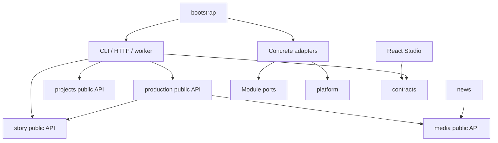

# Kiến trúc module và nghiệm thu refactor — 08/10/2026

Các finding phát hiện sau lượt nghiệm thu này được xử lý và kiểm chứng riêng trong [báo cáo follow-up](SOLID_REFACTOR_FOLLOWUP_2026-10-08.md). Số liệu test bên dưới là kết quả lịch sử của lượt refactor ban đầu.

## Phạm vi

Auto-Create-Video được chuyển sang một ứng dụng chia module theo nghiệp vụ, giữ cả video tin tức và episodic series. CLI, HTTP và worker dùng chung các use case. React là Studio chính; `/`, `/studio`, `/studio-next` và `/studio-legacy` mở React. Studio HTML cũ đã được loại bỏ; trang review và template video tin tức vẫn được giữ.

Việc triển khai dựa trên working tree hiện có, gồm thay đổi chưa commit của người dùng. Không reset hoặc stash working tree. Các đợt trong kế hoạch được thực hiện trong checkout này; chưa tạo commit hoặc PR riêng vì thay đổi có sẵn và refactor đang cùng nằm trong working tree.

Tên lệnh CLI và HTTP contract được giữ. API TypeScript nội bộ đã thay đổi: không còn các đường dẫn `src/bible`, `src/series`, `src/gateway`, `src/server`, `src/orchestration`, `src/tts` cũ. Vị trí dữ liệu, schema SQLite, cơ chế reconciliation và định dạng checkpoint/artifact được giữ; không có migration dữ liệu mới.

## Cấu trúc và chiều phụ thuộc

```text
src/
  apps/
    cli/                 # Tham số, registry lệnh, gọi use case
    http/                # Route, validation, response, SSE
    worker/              # Claim, lease, heartbeat, pause/cancel, supervisor
  bootstrap/             # Nối dependency, cấu hình, resource ownership
  modules/
    story/               # Phân tích truyện, screenplay, canon, memory
    production/          # Episode/season, shots/takes, QA, budget, dispatch
    media/               # TTS/audio, timeline, assembly, render, NLE, hậu kỳ
    news/                # Pipeline video tin tức
    projects/            # Settings, catalog, backup/restore
  contracts/             # DTO/schema browser-safe và execution/provider contracts
  platform/
    sqlite/              # Typed session, migrations, transaction values
    filesystem/          # Containment, package paths, atomic publication
    processes/           # FFmpeg và lifecycle của tiến trình
    observability/       # Logging, metrics, redaction

studio/
  app/                   # Shell, navigation, scope
  features/              # View/hook theo chức năng
  shared/api/            # Typed client, subscription
  shared/ui/             # Thành phần giao diện chung
```



Mỗi module có `domain`, `application`, `ports`, `adapters` và `index.ts`. Domain chứa quy tắc và tính toán thuần. Application điều phối qua port theo nhu cầu. Concrete adapter được nối tại bootstrap. Caller ở module khác và entrypoint chỉ import public `index.ts`; public API không re-export concrete adapters.

`story` và `media` không phụ thuộc ngược `production`. Module nghiệp vụ không import `apps` hoặc `bootstrap`; platform không import module nghiệp vụ. Studio chỉ import DTO/schema từ `contracts`, không kéo implementation backend vào bundle.

`npm run check:architecture` dùng TypeScript compiler API để kiểm tra import/export, dynamic import, inline import type, public API, adapter re-export trực tiếp/gián tiếp, domain I/O/env và chu kỳ runtime. Type-only import không được tính là cạnh runtime. Checker chạy trong CI và có fixture test chứng minh các trường hợp vi phạm bị chặn. Đây là kiểm tra kiến trúc tĩnh; nó không tự chứng minh mọi implementation đều tuân thủ hoàn toàn SOLID.

## Thay đổi theo đợt

| Đợt | Kết quả triển khai |
|---|---|
| 0 — Baseline | Sửa lỗi đóng khối QC; sửa tên hai test gateway để phản ánh durable-dispatch guard. Chụp snapshot source trước refactor và chạy baseline. |
| 1 — Contracts/bootstrap | Tách video/TTS contracts và helper thuần; gateway không import provider adapters. Factory đăng ký provider một lần; gateway inject được giữ nguyên. Composition root dùng chung cho runtime CLI/HTTP/worker. |
| 2 — Persistence/canon | `SqliteStoryStore` là adapter được nối ở bootstrap; repository nhận typed DB session và collaborator hẹp, không gọi ngược facade. Migrations nằm ở platform; các repository dùng cùng connection trong transaction. |
| 3 — Production | Coordinator gọi sáu pha prepare → audio → shots → evaluate/reroll → assemble → finalize, với đầu vào/đầu ra theo pha. Checkpoint qua port, không gọi ngược runtime. Manual finalize, review và pipeline dùng chung canon/QA/approval gates. |
| 4 — Dispatch/recovery | Provider adapters và durable dispatch thuộc production. Submit/poll/recovery giữ remote ID và reconciliation. Capability khai báo restore/cancel; lỗi điều khiển dùng code/disposition; atomic reservation là port bắt buộc. |
| 5 — Media/news | TTS/audio/render/assembly/NLE/hậu kỳ nằm ở media; các tính toán thuần tách khỏi đọc file. News nhận dependency từ root và dùng public media API. Cache fingerprint, process runner và atomic publication được giữ. |
| 6 — Entrypoints | HTTP tách feature routes và handler alias; business queries thành use case. NLE conform nhận workspace port. Worker supervisor tách khỏi HTTP. CLI tách 25 lệnh và registry, đóng resource tại root. |
| 7 — React | App trở thành shell; views/hooks theo feature. API client dùng DTO/unknown, lỗi có status/code; scope guard và cleanup chặn response/subscription cũ khi đổi series/episode/branch. |
| 8 — Packaging | Bỏ đường dẫn/facade cũ và Studio HTML; cập nhật build, asset copy, compiled worker, Docker và smoke. CI kiểm tra Windows/Linux với Node 22/24 cùng container smoke. |

## Các invariant cần giữ khi phát triển tiếp

### Dependency và lifecycle

- Thêm provider: implement video contract dưới production adapters, khai báo capability/rate metadata và đăng ký ở `bootstrap/video-gateway.ts`; không sửa production use case.
- TTS core nhận factory đã inject; không tự lựa chọn provider hoặc đọc cấu hình môi trường.
- Runtime chỉ đóng resource do chính nó tạo. `EpisodeRuntime` giữ nguyên gateway/store inject; `ResilientJobOrchestrator` chỉ dispose dispatch store tự tạo. `close/dispose` idempotent.
- Nhánh xử lý lỗi kiểm tra ownership trước khi ghi checkpoint, giữ nguyên code/disposition của lỗi lease/cancel; remux cũng không đổi lỗi điều khiển thành lỗi render chung.
- Không truyền facade hoặc registry dịch vụ trong execution context. `ExecutionContext` mô tả signal, checkpoint, ownership và progress; mỗi pha kiểm tra quyền sở hữu trước khi tiếp tục.

### Persistence, chi phí và recovery

- Repository canon/jobs/references/sources/production nhận cùng typed session; không tự mở connection mới trong transaction hiện tại.
- SQLite reservation giữ đường atomic. Canon commit lặp, take approval, rollback và lease guard tiếp tục được kiểm thử bằng DB thực.
- Series DB và coordination DB vẫn là hai DB với reconciliation; không tuyên bố có transaction chung xuyên hai DB.
- Paid production đi qua durable dispatcher. Có remote ID thì recovery poll/restore, không submit lại. Submit uncertain, hedge và chi phí uncertain phải đi qua reconciliation; không suy đoán lỗi tài chính từ câu chữ.
- Không đổi thuật toán QA, hạn mức, rate card hay mức song song trong refactor.

### Finalization

- QA unavailable/malformed, take chưa duyệt, thiếu media, beat coverage hoặc chi phí chưa được giải quyết chặn canon commit theo gate chung.
- Callback renderer phải tạo output có thể kiểm chứng; `canonCommitted` từ callback không được dùng để bỏ qua gate hoặc commit.
- Manual/demo vẫn hỗ trợ quyền `allowMockMedia` đã có; pipeline mock tự động không commit canon.
- Bộ đọc finalization chấp nhận cả cue chuẩn và cue cũ `id/speaker/text`, chuẩn hóa trong bộ nhớ, không sửa file đầu vào. Đây là tương thích artifact hiện có, không phải migration dữ liệu.
- NLE preview không publish hoặc mở take store. NLE apply publish timeline chính trước take approval; mirror timeline phụ ghi best effort với diagnostic, giữ semantics trước refactor. File và DB không có transaction chung.

### Error và UI

- Boundary nhận `unknown` và validate bằng schema hoặc type guard. Workflow errors có code/disposition; HTTP mapper và worker map code thay vì regex thông báo nghiệp vụ.
- Catch trong phần chuyển đổi phải có diagnostic, cleanup hoặc trạng thái rõ ràng. Logger tiếp tục redact secret. AST audit trên 375 file module/bootstrap/entrypoint backend không còn khối `catch` rỗng; các cleanup promise vẫn giữ semantics dọn file có chủ đích.
- Schema bản tin job cho phép `rawScreenplay` đã được server ẩn; schema tạo production request vẫn yêu cầu screenplay. Smoke browser chỉ nhận job episode mới và chặn nghiệm thu nếu UI hiện lỗi hoặc chưa nhận trạng thái hoàn tất qua subscription.
- Feature React phải giữ scope series/episode/branch, hủy subscription khi unmount và bỏ qua response đến trễ. Source polling có abort/cleanup.
- Vẫn còn một số `any` trong mapping SQL, compatibility code và annotation callback UI nội bộ. Không đặt mục tiêu xoá mọi `any` hoặc số dòng như chứng nhận clean code; port và boundary mới đã có type cụ thể.

## Kiểm chứng

Chạy từ thư mục project:

```powershell
npm run typecheck
npm run check:architecture
npm run build
npm test
node dist/cli.js --help
node dist/apps/cli/main.js series:help
npm run smoke:runtime
npm run smoke:browser
```

Baseline đầu tiên có 769 tests: 720 qua và 49 lỗi do sandbox chặn localhost/junction. Các ca bị chặn được chạy lại ngoài sandbox theo nhóm và qua; không ghi nhận baseline là một lượt 769/769 thành công. Lượt full đầu sau refactor có 813 tests: 812 qua, một lỗi tương thích cue cũ. Lỗi này đã được sửa và ca hai tập liên tiếp/finalize đã qua khi chạy lại.

Suite cuối đã hoàn tất trên source được giữ nguyên: 608 file đối chiếu hash không có thay đổi trong lượt chạy. Trạng thái nghiệm thu ở bảng dưới. Evidence cục bộ nằm dưới `output/solid-refactor-2026-10-08`, không commit output test.

| Kiểm tra | Kết quả |
|---|---|
| Typecheck backend + Studio | Qua |
| Architecture | 461 files, 1.027 runtime edges, 0 violations |
| Build TypeScript + React + asset copy | Qua |
| CLI/season sau tách lệnh | 18/18 tests qua, 3 files |
| Timeline/finalize/gates/architecture/error regression | 21/21 tests qua |
| NLE HTTP và application boundary | 11/11 tests qua, 3 files |
| Bootstrap lifecycle/SQLite/canon/provider sau bổ sung diagnostic | 53/53 tests qua, 4 files |
| Full suite trước guard lỗi ownership cuối | 818/818 tests qua, 123 files; 0 failed/skipped |
| Ownership/resume/remux/render sau guard cuối | 23/23 tests qua, 4 files |
| Error/control bổ sung | 11/11 tests qua, 2 files |
| SSE redacted và production boundary sau sửa schema | 9/9 tests qua, 2 files |
| Full suite sau guard ownership, trước test SSE mới | 823/823 tests qua, 123 files; 0 failed/skipped |
| Full suite sau schema SSE cuối | 824/824 tests qua, 123 files; 0 failed/skipped |
| Compiled CLI help | Qua cả shim và entrypoint mới |
| Runtime smoke | Qua: compiled worker, deduplication, pause/restart/resume, artifact read |
| Browser smoke | Qua: 17 màn hình, scope race, episode switch, tạo series/character/reference, lưu draft, sản xuất mock, đọc artifact |

Evidence của build cuối:

- Full test: `output/solid-refactor-2026-10-08/full-acceptance.json` (lượt trước: `full-final-complete.json`, `full-final-verified.json`).
- CLI/season: `output/solid-refactor-2026-10-08/cli-season-final.json`.
- NLE: `output/solid-refactor-2026-10-08/nle-final.json`.
- SSE summary/production boundary: `output/solid-refactor-2026-10-08/sse-summary-final.json`.
- Ownership/control: `output/solid-refactor-2026-10-08/ownership-final.json`, `error-control-final.json`.
- Hash source trong lượt nghiệm thu: `output/solid-refactor-2026-10-08/final-source-manifest.json`.
- Runtime: `output/clean-runtime-smoke-4aa6bc11-6b78-4e56-bc26-0e3f0f414957/smoke-result.json`.
- Browser: `output/browser-smoke-91ce83c2-e203-4197-b37c-267a488dd37d/browser-result.json` và `studio.png`.
- Asset preservation: `output/solid-refactor-2026-10-08/asset-preservation.json`. Schema SQL khớp byte với snapshot working tree; prompt/template giữ nguyên nội dung khi bỏ khác biệt newline.

Provider tests dùng fake/mock và HTTP fixtures; không gọi provider trả phí. Đã thử khởi động Docker Desktop ở chế độ nền; engine vẫn báo `stopped`, API `info` trả HTTP 500 cả với version 1.56 và 1.45. Không build image hoặc chạy container smoke; phiên Docker thử nghiệm đã đóng, không đổi cấu hình engine. Evidence: `output/solid-refactor-2026-10-08/container-attempt.json`. Ma trận Linux/Node 22/24 và container đã được cập nhật trong CI nhưng chưa có kết quả CI từ checkout này. Vì vậy kết quả local xác nhận Windows/Node 24, không thay thế nghiệm thu Linux hay provider thật.

## Hướng dẫn review working tree

Review theo module và trách nhiệm, thay vì coi rename hàng loạt là toàn bộ refactor. Điểm bắt đầu: `bootstrap/episode-runtime.ts`, production coordinator và ports, repository sessions, `apps/http/studio-api.ts`, `apps/cli/series.ts`, `studio/app/App.tsx`, rồi architecture checker.

Nếu cần chia commit/PR, dùng tám đợt trong bảng trên và đối chiếu snapshot trước refactor để giữ các thay đổi người dùng đã có. Không dùng reset hoặc staging toàn bộ repo để tạo lại baseline. Không xoá dữ liệu/output đang sử dụng chỉ vì source đã chuyển thư mục.
